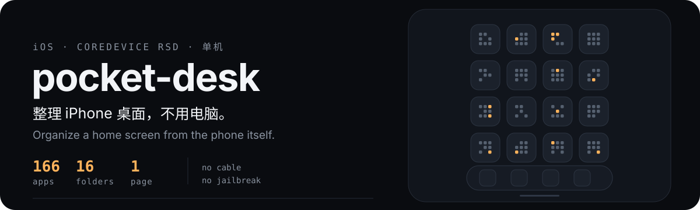
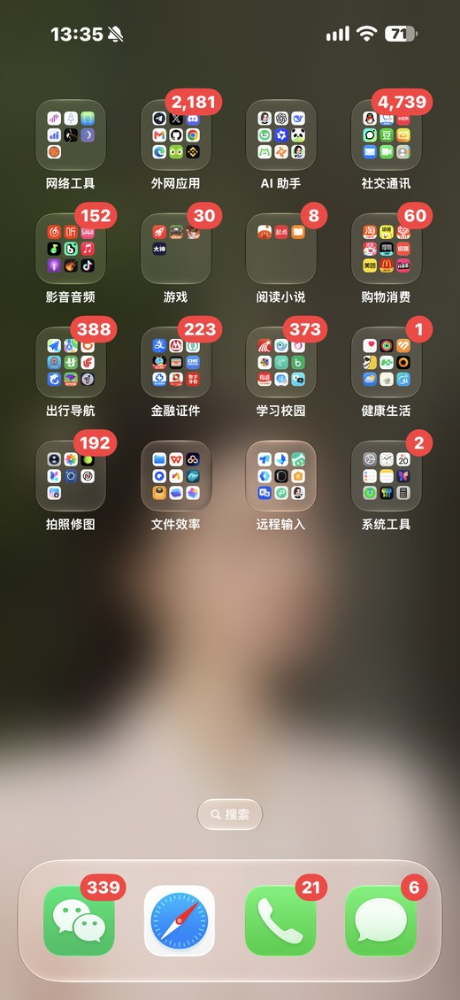

<p align="center">
  
</p>

<p align="center">
  <a href="#quick-start">Quick start</a> ·
  <a href="#how-it-works">How it works</a> ·
  <a href="#rule-files">Rule files</a> ·
  <a href="#caveats">Caveats</a> ·
  <a href="docs/PITFALLS.md">Pitfalls</a>
</p>

<p align="center">
  <a href="README.md">中文</a> | <b>English</b>
</p>

---

Organize an iPhone home screen from the iPhone itself. No cable, no jailbreak,
no app to install.

`pocketdesk` talks to the device's own CoreDevice RSD service, reads the
SpringBoard icon state, groups apps into folders according to a plain JSON rule
file, and writes the result back — packed into as few pages as the real grid
allows.

<p align="center">
  
</p>

<p align="center">
  <sub>166 apps → 16 folders → 1 page. The dock is left untouched.</sub>
</p>

## What it is for

iOS only lets you arrange the home screen by hand. With a few hundred apps, one
tidy-up session costs half an hour, and no third-party app can touch
`SpringBoard`'s icon state anyway.

`pocketdesk` reads and writes that state directly: group apps by bundle id,
compute page count from the device's real grid geometry, write it once. About
40 seconds end to end.

**It does not decide your categories for you.** Categories are plain text in
`pocketdesk/presets/*.json`.

## Quick start

Requires iOS 17+ (verified on iOS 27.0.1),
[LocalDevVPN](https://apps.apple.com/app/localdevvpn/id6755608870) (free),
Python 3.10+, Node.js.

```bash
# 1. install (not on PyPI yet — from source)
git clone https://github.com/feiwell/pocket-desk.git
cd pocket-desk && pip install .

# 2. pairing record (holds a private key: mode 600, never sync it)
mkdir -p ~/.config/pocketdesk
cp /path/to/pairing.plist ~/.config/pocketdesk/pairing.plist
chmod 600 ~/.config/pocketdesk/pairing.plist

# 3. preflight: pairing record + loopback reflection
pocketdesk check

# 4. look at the current layout
pocketdesk list

# 5. preview a plan (nothing is written)
pocketdesk plan --rules fine

# try rules with no device at all, from a saved snapshot
pocketdesk plan --rules fine --from snapshot.json --capacity 24

# 6. commit it (a snapshot is taken first)
pocketdesk plan --rules fine --apply

# roll back
pocketdesk restore ~/.cache/pocketdesk/backup/before_apply_*.json
```

`check` never touches port `49152`, so it is safe to run repeatedly; the
remoted daemon throttles clients that fail handshakes repeatedly.

## How it works

```
LocalDevVPN reflects 10.7.0.1 back to the device
  → RPPairing handshake     bare integer wireProtocolVersion
  → pair-verify             signs with the pairing record's Ed25519 key
  → createListener          device opens a tunnel listener on a dynamic port
  → Node TLS-PSK bridge     relays that port onto a local unix socket
  → CDTX establish          returns an RSD address + client parameters
  → UserspaceTun            userland PyTCP stack
  → RSD ready               85 system services
  → SpringBoardServices     read / write iconState
```

Every step has exactly one working form; the alternatives fail silently. The
full list of pitfalls (24 entries, including original errors and layout safety
boundaries) is in
[docs/PITFALLS.md](docs/PITFALLS.md).

### How pages are computed

Ask the device for its grid instead of assuming:

```python
svc = SpringBoardServicesService(rsd)
try:
    await svc.connect()  # construction alone does not connect
    m = await svc.get_homescreen_icon_metrics()
finally:
    await svc.close()
# homeScreenIconColumns=4 × homeScreenIconRows=6 → 24 items per page
```

Then **split pages yourself** at 24. iOS renders page boundaries exactly as
given and will not backfill gaps — get this wrong and 24 items still take two
pages.

## Rule files

Two ship with the package:

| Rule | Groups | Fits |
| --- | ---: | --- |
| `fine` | 16 | A Chinese daily-driver phone: keeps VPN tools apart from apps that need them, splits media/games/reading |
| `default` | 12 | A generic starting point |

Both live in `pocketdesk/presets/`. Put your own in
`~/.config/pocketdesk/rules/mine.json`:

```json
{
  "name": "mine",
  "groups": {
    "Social": ["com.tencent.xin", "com.apple.MobileSMS"],
    "Tools":  ["com.apple.Preferences"]
  },
  "first_page": []
}
```

```bash
pocketdesk plan --rules mine            # by name
pocketdesk plan --rules ./mine.json     # or by path
pocketdesk rules --init ~/.config/pocketdesk/rules/mine.json   # starter file
```

Apps that match no group are **not dropped** — they stay as loose icons on the
last page.

## Incremental merge: keep the existing layout

Use `merge`, not a full `plan`, to collect newly scattered icons without
reorganizing existing folders. `mapping.json` maps **`displayIdentifier`
(bundle id) → exact existing folder name**, never an ambiguous app display name:

```json
{
  "com.example.reader": "Reading",
  "com.example.utility": "Tools"
}
```

```bash
pocketdesk merge --assignments mapping.json                 # preview only
pocketdesk merge --assignments mapping.json --from snapshot.json --out proposed.json
# Inspect the preview and obtain explicit approval before writing:
pocketdesk merge --assignments mapping.json --apply         # backup, write, verify
```

- Assignments must cover **every loose icon on pages after the last page that
  contains a folder**, exactly once. Loose icons on earlier pages, unknown IDs,
  unknown/ambiguous folder names, duplicate JSON keys/icons, widgets, nested
  folders and malformed states are rejected without writing.
- No new folders or repacking: preserve the raw Dock, folder order, existing
  members and existing page boundaries. Append additions to the target folder's
  last internal page in source order; remove the emptied trailing home-screen
  pages. Mapping key order does not change icon order.
- Index 0 in `[dock, page1, ...]` is **not a page**. Keep raw dictionaries and
  `datetime` objects via deep copies; pass them to official
  `set_icon_state(raw_plan)`, never through a JSON round-trip or hand-built
  plist/framing.
- `plan` and `merge` default to dry-run. `--from` cannot be combined with
  `--apply`. `restore` is an explicit write command.

### What successful verification means

A snapshot is saved before writing. `plan --apply`, `merge --apply` and
`restore` read back and compare Dock identities/order, icon conservation and
uniqueness, folder membership/order, internal folder pages and home-screen
page boundaries — not just counts. Planning preserves the entire raw Dock.
Read-back tolerates row wrappers and refreshed names/versions/dates (non-layout
metadata), not changed positions. Mismatches return nonzero, never success.
A timeout/disconnection means **outcome unknown**: iOS may already have applied
the request. Inspect/read back before retrying. There is no automatic rollback.
iOS repaginating a folder or adding App Library icons also fails conservatively.

New JSON snapshots encode datetimes with a type marker. For legacy snapshots
written with `default=str`, only an app's `iconModDate` is parsed as an ISO
datetime (including space-separated timestamps); invalid dates are rejected.
Other strings are never guessed into dates. This repairs types, not stale
installed-app inventories. Never upload snapshots, pairing files or credentials.

## Offline tests

`pyproject.toml` has no pytest-specific configuration. Use standard-library
unittest, with no extra test dependency:

```bash
python3 -m unittest discover -s tests -v
```

All layouts are synthetic. Services, tunnels and preflight probes are mocked;
no real device backup is read and no device is contacted. The root
[SKILL.md](SKILL.md) provides a concise execution/safety guide.

## Commands

| Command | What it does |
| --- | --- |
| `check` | Preflight: pairing record + loopback reflection, without touching device ports |
| `list` | Print the current home screen: dock, folders and loose icons per page |
| `grid` | Print the device's real grid geometry |
| `plan --rules X` | Build and preview a layout (dry run by default) |
| `plan --rules X --apply` | Snapshot, write, and read back |
| `merge --assignments mapping.json` | Merge trailing loose icons into existing folders (dry run) |
| `merge --assignments mapping.json --apply` | Snapshot, merge, verify positions/membership/page boundaries |
| `restore <snapshot>` | Restore a snapshot and verify the actual read-back |
| `rules` | List available rule sets |

## Caveats

- **The pairing record is a private key.** Keep it out of iCloud, Dropbox, and
  any synced folder.
- **`setIconState` pulls every App Library app back onto the home screen.** All
  166 appear, and **no API can return them** — only manual "Remove from Home
  Screen". Do this with eyes open.
- **The dock is item 0 of the top-level array, not the first page.** Treat it as
  a page and the dock is wiped.
- **Shadowrocket and similar proxy clients cannot replace LocalDevVPN.** They
  forward traffic; their config has no `IP-Rewrite` section, and
  `tun-excluded-routes` keeps `10.0.0.0/8` out of the TUN by default. Running both
  does not help — `check` reports `connected but no echo`, which is exactly the
  "connected but nothing came back" signature.
- **Only one tunnel at a time.** Concurrent sessions fight over remoted's port.
- **Do not retry in a loop.** Repeated failed handshakes make remoted back off
  for roughly 30 minutes.
- Verified on iPhone18,2 / iOS 27.0.1 / LocalDevVPN / Alpine aarch64. Other iOS
  versions should work (the tunnel layer is generic) but were not tested here.

## It is not

- Not a jailbreak; no root required.
- Does not modify system files — it only calls Apple's own developer services.
- Does not upload anything. Everything runs locally; the only external piece is
  LocalDevVPN's loopback reflection.

## License

MIT. The tunnel and pairing handshake derive from
[OpenMinis/MinisSkills](https://github.com/OpenMinis/MinisSkills)
`coredevice-toolkit` (MIT) — see [NOTICE](NOTICE).

The layout format, dock handling, paging behaviour and field names were
established by direct inspection and are written up in
[docs/FORMAT.md](docs/FORMAT.md).
