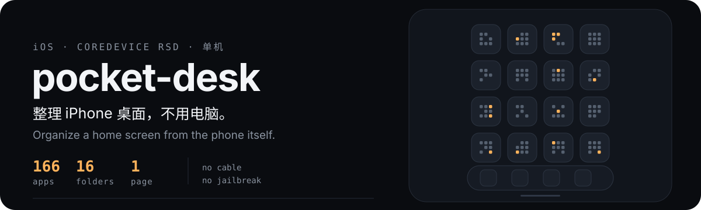

<p align="center">
  
</p>

<p align="center">
  <a href="#快速开始">快速开始</a> ·
  <a href="#工作原理">工作原理</a> ·
  <a href="#规则文件">规则文件</a> ·
  <a href="#注意事项">注意事项</a> ·
  <a href="docs/PITFALLS.md">踩坑记录</a>
</p>

<p align="center">
  <b>中文</b> | <a href="README.en.md">English</a>
</p>

---

在 iPhone 上整理 iPhone 的桌面。不用连电脑，不用越狱，不用装 App。

它通过一台设备自己跟自己说话的底层通道（CoreDevice RSD）读取主屏布局，
按你写的规则把 166 个 App 收进十几个文件夹，一页装完。

<p align="center">
  
</p>

<p align="center">
  <sub>整理后：166 个 App → 16 个文件夹 → 1 页。dock 保持不动。</sub>
</p>

## 它解决什么

iOS 的桌面布局只能手动拖，装了几百个 App 之后整理一次要半小时。
系统没有"按类别归组"的入口，第三方 App 也碰不到 `SpringBoard` 的图标状态。

`pocketdesk` 直接读写这个状态：把 App 按 bundle id 分到文件夹，
按设备真实的网格容量算页数，然后一次性写回去。整段大约 40 秒。

**它不会替你决定分类。** 分类是 `pocketdesk/presets/*.json` 里的纯文本，你自己改。

## 快速开始

需要：iOS 17+（实测 iOS 27.0.1）、[LocalDevVPN](https://apps.apple.com/app/localdevvpn/id6755608870)（免费）、
Python 3.10+、Node.js。

```bash
# 1. 装依赖（尚未发布到 PyPI，从源码装）
git clone https://github.com/feiwell/pocket-desk.git
cd pocket-desk && pip install .

# 2. 放配对文件（含私钥，务必 600）
mkdir -p ~/.config/pocketdesk
cp /path/to/pairing.plist ~/.config/pocketdesk/pairing.plist
chmod 600 ~/.config/pocketdesk/pairing.plist

# 3. 体检：配对文件 + 回环反射
pocketdesk check

# 4. 看当前桌面
pocketdesk list

# 5. 预览整理方案（不改设备）
pocketdesk plan --rules fine

# 没有设备也能试规则：用之前存下的快照*离线*预览
pocketdesk plan --rules fine --from snapshot.json --capacity 24

# 6. 确认无误后写入（自动备份）
pocketdesk plan --rules fine --apply

# 回滚
pocketdesk restore ~/.cache/pocketdesk/backup/before_apply_*.json
```

`pocketdesk check` 通过后才会走到隧道。它不碰设备的 `49152` 端口，
所以反复跑也不会触发限流。

## 工作原理

```
LocalDevVPN 把 10.7.0.1 反射回本机
  → RPPairing 握手          bare integer wireProtocolVersion
  → pair-verify             用 pairing.plist 的 Ed25519 私钥签名
  → createListener          设备开一个动态端口的隧道监听
  → Node TLS-PSK 桥接        把该端口转成本地 unix socket
  → CDTX establish          拿到 RSD 地址 + 客户端参数
  → UserspaceTun            纯用户态协议栈（PyTCP）
  → RSD 就绪                 85 个系统服务
  → SpringBoardServices      读 / 写 iconState
```

这条链上每一步都只有一种写法能通，其他都会静默失败。
完整的失败清单（19 条，含原始报错）在 [docs/PITFALLS.md](docs/PITFALLS.md)。

### 布局怎么算的

设备每页能放多少，直接从设备问，不猜：

```python
svc = SpringBoardServicesService(rsd)
m = await svc.get_homescreen_icon_metrics()
# homeScreenIconColumns=4 × homeScreenIconRows=6 → 24 项/页
```

写入时**自己按 24 切页**。iOS 严格按你给的页边界渲染，不会把后面的项目回填到前页空位——
这一点搞错就会出现"明明只用了 24 项却占两页"。

## 规则文件

`pocketdesk/presets/` 里带两套，也可以放自己的：

| 规则 | 组数 | 适合 |
| --- | ---: | --- |
| `fine` | 16 | 中文日常机：把梯子和需要梯子的 App 分开，影音/游戏/阅读拆开 |
| `default` | 12 | 通用起点 |

自己的规则放 `~/.config/pocketdesk/rules/mine.json`：

```json
{
  "name": "mine",
  "groups": {
    "社交": ["com.tencent.xin", "com.apple.MobileSMS"],
    "工具": ["com.apple.Preferences"]
  },
  "first_page": []
}
```

```bash
pocketdesk plan --rules mine            # 用名字
pocketdesk plan --rules ./mine.json     # 或用路径
pocketdesk rules --init ~/.config/pocketdesk/rules/mine.json   # 生成模板
```

没匹配到任何分组的 App **不会丢**，会作为散图标排在最后一页。

## 命令

| 命令 | 作用 |
| --- | --- |
| `check` | 体检：配对文件 + 回环反射（不碰设备端口） |
| `list` | 打印当前桌面：dock、每页的文件夹与散图标 |
| `grid` | 打印设备真实网格参数 |
| `plan --rules X` | 生成方案并预览，默认 dry-run |
| `plan --rules X --apply` | 备份后写入，再回读校验 |
| `restore <snapshot>` | 回滚到某个快照 |
| `rules` | 列出可用规则集 |

## 注意事项

- **配对文件是私钥。** 不要放进 iCloud / 网盘 / 任何同步目录。
- **`setIconState` 会把 App 资源库里的 App 全部放回主屏。** 166 个 App 会全部显形，
  而且**没有 API 能收回资源库**，只能手动"从主屏幕移除"。写入前请知情。
- **dock 是顶层数组的第 0 项，不是第一页。** 当普通页处理会把 dock 清空。
- **同一时刻只能有一条隧道。** 并发会互抢 `remoted` 的端口。
- **不要连续重试。** 短时间内多次失败握手会触发 remoted 退避，冷却约 30 分钟。
- 本人实测环境：iPhone18,2 / iOS 27.0.1 / LocalDevVPN / Alpine aarch64。
  其他 iOS 版本理论上兼容（隧道层来自通用实现），但未逐一验证。

## 它不是

- 不是越狱工具，不需要 root。
- 不改任何系统文件，只走 Apple 自己的开发者服务。
- 不上传你的数据；所有逻辑在本机，唯一的外部依赖是 LocalDevVPN 的本地回环。

## 许可

MIT。隧道与握手部分来自 [OpenMinis/MinisSkills](https://github.com/OpenMinis/MinisSkills)
的 `coredevice-toolkit`（MIT），详见 [NOTICE](NOTICE)。

桌面布局格式、dock 与分页行为、字段名等细节是自己逆向确认的，
整理在 [docs/FORMAT.md](docs/FORMAT.md)。
